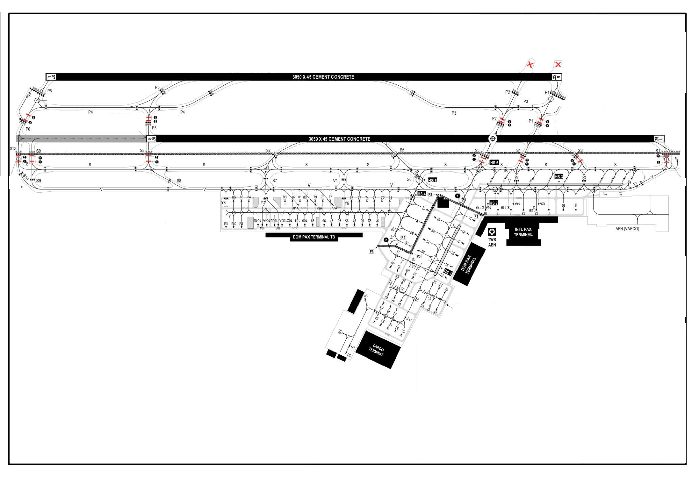
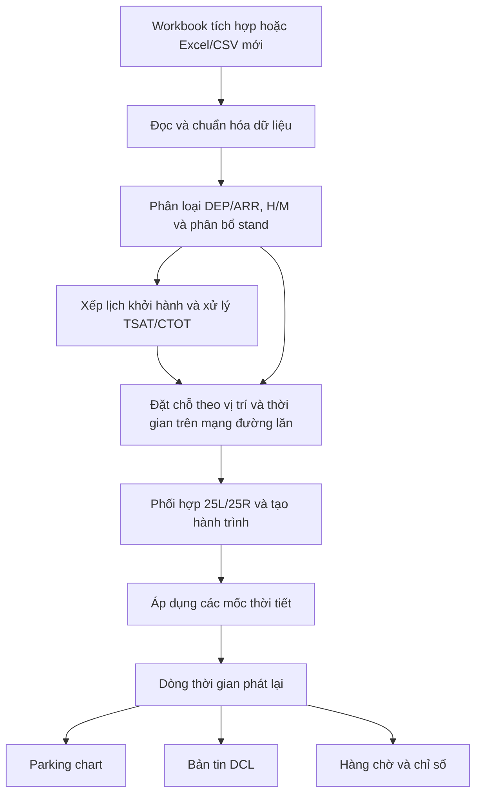

# ỨNG DỤNG CPDLC–DCL TRONG QUẢN LÝ LUỒNG KHÔNG LƯU
## TẠI CẢNG HÀNG KHÔNG SÂN BAY TÂN SƠN NHẤT

**Nhóm 5 · Lớp 23ĐHKL01**

**[Truy cập ứng dụng](https://tsn-flight-management.vercel.app/)** · **[Chạy cục bộ](#cài-đặt-và-chạy-cục-bộ)** · **[Dữ liệu](#dữ-liệu-đầu-vào)** · **[Kiểm thử](#kiểm-thử)**

Ứng dụng web mô phỏng phối hợp **tàu bay đi và đến tại VVTS**, kết hợp lịch TSAT/CTOT, chuyển động trên parking chart và chuỗi điện văn DCL. Người dùng có thể phát lại một ngày khai thác, theo dõi từng chuyến và bật mưa để quan sát quá trình xử lý chuyến quá hạn CTOT.

Giao diện sử dụng tiếng Việt cùng thuật ngữ hàng không. Việc đọc workbook, tính lịch và phát lại diễn ra trong trình duyệt; ứng dụng có thể chạy cục bộ hoặc triển khai dưới dạng website tĩnh.

## Thông tin đề tài

| Nội dung | Thông tin |
| --- | --- |
| Nhóm thực hiện | **Nhóm 5** |
| Lớp | **23ĐHKL01** |
| Giảng viên hướng dẫn | **Nguyễn Ngọc Hoàng Quân** |
| Sân bay mô phỏng | Tân Sơn Nhất — **VVTS** |
| Cấu hình khai thác | **25L / 25R** |

| Thành viên | Mã số sinh viên |
| --- | --- |
| Châu Ngọc Xuân | 2331710004 |
| Nguyễn Doãn Phương | 2331710008 |
| Phan Ngọc Trâm | 2331710044 |
| Dương Thị Hương Thảo | 2331710038 |

## Chức năng

| Phân hệ | Khả năng hiện có |
| --- | --- |
| **Nguồn dữ liệu** | Bốn workbook tích hợp; nhập `.xlsx`, `.xls`, `.csv`; chọn ngày khai thác; đọc các sheet DEP/ARR nếu có |
| **Parking chart** | Hiển thị vị trí tàu tại stand, đường lăn và đường băng; chọn chuyến; phóng to, thu nhỏ, đặt lại bản đồ |
| **Tàu đi** | Rời stand, lăn đến S1, vào 25L, chờ tàu đến vượt mốc 25R khi cần, chạy đà và cất cánh |
| **Tàu đến** | Tiếp cận 25R, hạ cánh, ưu tiên thoát P4, dùng P5 khi tuyến ưu tiên bận, chờ cắt 25L rồi lăn về stand |
| **Điều phối** | Xét cửa sổ CTOT, hạng H/M, khả năng tiếp nhận của stand và chiếm dụng tuyến đường lăn |
| **Thời tiết** | Bật/tắt thời tiết xấu thủ công; xử lý hết hạn CTOT; tự khôi phục lịch khi thời tiết tốt trở lại |
| **Điện văn DCL** | RCD → FSM → CLD → CDA; nội dung theo từng dòng; thông báo hết hạn và điều chỉnh TSAT/CTOT |
| **Phát lại** | Phát/tạm dừng, tua thời gian, tốc độ 1×, 10×, 30×, 60×; tiếp tục sang ngày kế tiếp nếu lịch kết thúc muộn |
| **Theo dõi kết quả** | Tổng chuyến, tổng thời gian chờ, số chuyến không tuân thủ CTOT; hàng chờ có tìm kiếm và lọc trạng thái |
| **Ghi workbook** | Ghi các trường kết quả vào tệp đã mở khi trình duyệt có quyền ghi trực tiếp |

## Quy tắc điều phối

Các quy tắc dưới đây mô tả **mô hình đang được cài đặt trong ứng dụng**.

### Luồng tàu bay

| Luồng | Trình tự |
| --- | --- |
| **Khởi hành — DEP** | Stand → đường lăn sân đỗ → điểm chờ S1 → vào 25L → chạy đà → cất cánh |
| **Hạ cánh — ARR** | Tiếp cận 25R → hạ cánh → nhánh thoát P4/P5 → điểm chờ P5 → cắt 25L → S8 → đường lăn V → stand |

- Tàu đến ưu tiên **P4**; sử dụng **P5** khi tuyến ưu tiên không khả dụng.
- Tàu đến chờ tại P5 nếu 25L đang có tàu đi. Sau khi tàu đi hiện tại rời đường băng và đủ thời gian giãn cách, tàu đến được ưu tiên cắt 25L; tàu đi kế tiếp phải chờ. Lịch đường lăn được tính lại quanh lượt cắt để giữ phân cách tại các đường chung và stand.
- Khi tàu đến đang trong đoạn tiếp cận được theo dõi, tàu đi chỉ được **bắt đầu chạy đà sau khi tàu đến vượt mốc 25R** trên chart. Tàu đi có thể vào 25L và chờ tại đó.
- Nhánh thoát P4/P5, điểm chờ và đường cong S8 → V được căn theo ảnh `PARKING_CHART_clean.png`, trong hệ tọa độ gốc **2048 × 1413**.
- Chuyến nội địa được phân bổ vào nhóm stand **DOM PAX TERMINAL/T3**; chuyến quốc tế vào nhóm stand **INTL PAX TERMINAL**. **Stand 16 thuộc khu quốc tế.**
- Việc phân bổ xét nhóm chuyến bay, hạng tàu bay và thời điểm stand khả dụng; các giá trị tự sinh có tính tái lập với cùng dữ liệu nguồn.

<details>
<summary>Xem parking chart tham chiếu</summary>



</details>

### Hạng tàu bay và tốc độ

| Hạng | Các họ tàu bay được nhận diện | Tốc độ tiếp cận |
| --- | --- | ---: |
| **Heavy — H** | Boeing 747, 767, 777, 787; Airbus A330, A350 | **160 kts** |
| **Medium — M** | Các loại còn lại trong phạm vi mô hình, gồm Boeing 737, Airbus A320/A321 và ATR 72 | **145 kts** |

**Tốc độ lăn: 20 kts.** Mô hình cất cánh tăng tốc đến **150 kts** trên chiều dài đường băng mô phỏng **3.059 m**. Thời gian chạy đà và nội suy vị trí được liên kết để tàu di chuyển liên tục đến khi rời đường băng.

Hai lượt **H không được đứng liên tiếp trong thứ tự cất cánh**. Lịch phải có đủ lượt M để thỏa điều kiện này; hệ thống báo lỗi nếu không thể tạo thứ tự hợp lệ.

### TSAT, CTOT và điểm X

| Thuật ngữ | Cách sử dụng trong ứng dụng |
| --- | --- |
| **TSAT — Target Start-Up Approval Time** | Mốc phê duyệt khởi động mục tiêu; trong mô hình gắn với thời điểm bắt đầu lăn/rời stand |
| **CTOT — Calculated Take-Off Time** | Mốc cất cánh được cấp, có cửa sổ chấp nhận **−5 đến +10 phút** |
| **ATD** | Mốc khởi hành thực tế dùng để tính kết quả; trong ứng dụng là thời điểm bánh rời đường băng, lưu ở `wheelsOff`/`ActualTakeoff` |
| **Điểm X** | Điểm quyết định xử lý hết hạn CTOT trên tuyến lăn gần S1 |

Cửa sổ hợp lệ bao gồm hai đầu mút:

```text
CTOT − 5 phút ≤ thời điểm cất cánh ≤ CTOT + 10 phút
```

| Trạng thái khi hết hạn CTOT | Cách xử lý |
| --- | --- |
| Còn tại stand | Tiếp tục chờ tại stand, nhận **TSAT mới** |
| Đã lăn, chưa qua điểm X | Bố trí quay về vị trí đỗ khả dụng gần nhất và chờ cấp lịch mới |
| Đã qua điểm X | Được tiếp tục khởi hành, đánh dấu **Không tuân thủ CTOT** và xử lý **CTOT mới** |

Điều chỉnh được phân biệt theo vị trí: ở stand sử dụng **Revised TSAT**; khi đã ở ngoài sân đỗ sử dụng **Revised CTOT**. CTOT gốc được giữ để kiểm tra việc tuân thủ cửa sổ cất cánh.

### Cách tính tổng thời gian chờ

Chỉ số **TỔNG THỜI GIAN CHỜ** cộng thời gian từ **TSAT mới nhất đã được cấp** đến lúc cất cánh thực tế của từng chuyến. Trong lúc phát lại, chuyến chưa cất cánh được tính đến thời điểm hiện tại.

```text
Trước TSAT:
    Thời gian chờ chuyến = 0

Từ TSAT đến khi cất cánh:
    Thời gian chờ chuyến = thời điểm hiện tại − TSAT mới nhất

Sau khi cất cánh:
    Thời gian chờ chuyến = ATD − TSAT mới nhất
```

Ví dụ: RCD phát lúc **10:00**, TSAT **10:10**, cất cánh lúc **10:20** thì thời gian chờ là **10 phút**. Tàu xuất hiện tại stand ngay khi phát RCD; giai đoạn **10:00–10:10** chưa được cộng vào bộ đếm.

Khi cấp **Revised TSAT**, bộ đếm sử dụng mốc mới từ thời điểm cấp và bằng 0 nếu chưa tới TSAT đó. Nếu chỉ cấp **Revised CTOT**, TSAT đang áp dụng được giữ làm mốc. Trạng thái tuân thủ CTOT được kiểm tra riêng với cửa sổ −5/+10 phút.

### Thời tiết xấu thủ công

1. Chạy lịch và phát lại đến thời điểm muốn tạo tình huống.
2. Bật **Thời tiết xấu** để dừng cấp phép cất/hạ cánh mới. Chuyển động đã được cho phép vào đường băng hoặc bắt đầu tiếp cận được xử lý theo trạng thái đang thực hiện.
3. Đồng hồ tiếp tục chạy; hệ thống theo dõi CTOT và xử lý từng tàu theo vị trí, thời điểm hết hạn và khả năng tiếp nhận của stand.
4. Tắt thời tiết xấu để khôi phục khai thác, cấp lại TSAT/CTOT theo trạng thái và tiếp tục điều phối.

Các lần bật/tắt được lưu theo dòng thời gian. Khi tua về quá khứ rồi thay đổi thời tiết, kịch bản sau thời điểm đó được tính lại.

## Điện văn DCL

| Bản tin | Vai trò trong kịch bản |
| --- | --- |
| **RCD** | Tổ lái gửi yêu cầu huấn lệnh khởi hành |
| **FSM** | Phản hồi đã nhận, đang xử lý, chờ, từ chối hoặc thông báo điều chỉnh |
| **CLD** | Cấp huấn lệnh khởi hành, kèm thông tin TSAT |
| **CDA** | Tổ lái xác nhận đã nhận huấn lệnh |

Bảng DCL hiển thị **giờ LT, chiều trao đổi ACFT ↔ ATC, nội dung điện văn và kết quả**. Nội dung tách theo từng dòng và xuất hiện theo thời điểm trong kịch bản. Ví dụ CLD:

```text
CLD 1300 011026 VVTS PDC 001
HVN1344 CLRD TO VVCR OFF
25L VIA SID DEMO1
SQUAWK 2201
TSAT 1305
```

Kịch bản còn có nhánh từ chối/timeout, yêu cầu gửi lại, thông báo `CTOT EXPIRED`, `TSAT REVISED`, `CTOT REVISED` và khôi phục sau thời tiết xấu.

## Dữ liệu đầu vào

### Bốn workbook tích hợp

| Bộ dữ liệu | Tệp | Phạm vi |
| --- | --- | --- |
| **Cập nhật 21.10.2026 — mặc định** | [`21102026.xlsx`](public/samples/21102026.xlsx) | Khai thác **01.10.2026**; **70 DEP + 30 ARR** |
| Chuyên đề — tàu đi và đến | [`chuyen-de.xlsx`](public/samples/chuyen-de.xlsx) | Khai thác **01.10.2026**; **70 DEP + 30 ARR** |
| Bộ dữ liệu 7 ngày | [`7-days.xls`](public/samples/7-days.xls) | **01–07.11.2023** |
| Bộ dữ liệu 3 ngày | [`3-days.xls`](public/samples/3-days.xls) | **03–05.11.2023** |

Trong `21102026.xlsx`, trường `Compliance` đánh dấu **25 chuyến “Không tuân thủ”** để tạo tình huống bắt buộc vượt hạn CTOT. Đây là dữ liệu điều khiển kịch bản, không chỉ là nhãn hiển thị. Các chuyến còn lại vẫn chịu tác động của mật độ khai thác, thời tiết và ràng buộc chung.

Tên tệp cập nhật không thay thế ngày khai thác: ứng dụng đọc ngày từ dữ liệu bên trong workbook.

### Định dạng và trường dữ liệu

Hỗ trợ **`.xlsx`, `.xls`, `.csv`**. Nếu workbook có sheet `DEP` hoặc `ARR`, bộ đọc sử dụng các sheet này và xác định chiều chuyến theo tên sheet. Nếu không có, ứng dụng đọc sheet đầu tiên và phân loại theo sân bay đi/đến.

| Trường | Nội dung |
| --- | --- |
| `CallSign` | Mã hiệu chuyến bay |
| `FlyDate` / `Date` | Ngày khai thác |
| `PlaneTypeCode` / `AircraftType` | Loại tàu bay, dùng xác định hạng H/M |
| `AirportDeliveryCode` | Sân bay đi; chuyến đi từ Tân Sơn Nhất có giá trị `VVTS` |
| `AirportReceiptCode` | Sân bay đến; chuyến đến Tân Sơn Nhất có giá trị `VVTS` |
| `FlightDirection` | `DEP` hoặc `ARR` nếu được cung cấp |
| `ScheduledDeparture` / `STD` / `DeliveryTime` | Mốc lịch của chuyến đi |
| `ScheduledArrival` / `ATA` / `STA` | Mốc hạ cánh của chuyến đến, theo thứ tự ưu tiên bộ đọc |
| `CTOT` | CTOT gốc; hỗ trợ ISO timestamp, giờ đồng hồ và phần ngày dạng số của Excel |
| `TSAT`, `StandReadyAt`, `Stand` | Các mốc và vị trí đỗ nếu đã có |
| `TaxiMinutes` | Thời gian lăn đầu vào; bước dựng hành trình tiếp tục xét chiều dài tuyến và tốc độ mô hình |
| `Compliance` | `Không tuân thủ` kích hoạt kịch bản quá hạn CTOT bắt buộc |

Ví dụ CSV cho một chuyến đi:

```csv
CallSign,FlyDate,PlaneTypeCode,AirportDeliveryCode,AirportReceiptCode,STD,CTOT,Compliance
HVN1344,01/10/26,A321,VVTS,VVCR,13:05,13:20,Không tuân thủ
```

Các mốc chỉ có giờ được ghép với ngày khai thác. Timestamp ISO có múi giờ được giữ theo thời điểm đã cung cấp; giao diện hiển thị **LT theo múi giờ trình duyệt**. Với dữ liệu giờ địa phương Tân Sơn Nhất, máy chạy ứng dụng cần dùng múi giờ **UTC+7** để cách hiển thị nhất quán.

### Chuẩn hóa và bổ sung

- Trường thiếu có thể được sinh để phục vụ mô phỏng: lịch, CTOT, stand, hạng tàu bay và thông tin đường lăn.
- **CTOT tự sinh** được xét sau phân bổ stand để tránh tạo slot hết hạn trước lúc tàu sẵn sàng. **CTOT có trong nguồn** được giữ làm mốc đánh giá.
- Phân loại nội địa/quốc tế hiện dựa vào mã sân bay Việt Nam dạng `VVxx`; đây là quy tắc giản lược của mô hình.
- Các giá trị tự sinh ổn định theo dữ liệu nguồn, không thay đổi ngẫu nhiên giữa mỗi lần chạy cùng đầu vào.
- Chạy mô phỏng không tự ghi đè workbook mẫu. Các tệp trong `public/` được phát hành cùng website và có thể truy cập bằng URL.

## Cài đặt và chạy cục bộ

Yêu cầu **Node.js 20 trở lên**, npm và trình duyệt hiện hành. Chrome/Edge hỗ trợ chọn tệp và ghi trực tiếp khi người dùng cấp quyền.

```bash
git clone https://github.com/MatthewLK13/Flight-Management.git
cd Flight-Management
npm ci
npm run dev
```

Mở địa chỉ localhost do Vite hiển thị. Nếu cần chọn cổng:

```bash
npm run dev -- --port 4175
```

### Hướng dẫn sử dụng

1. Chọn bộ dữ liệu tích hợp hoặc **Tải tệp mới**.
2. Chọn **Ngày khai thác**, giữ cấu hình **25L / 25R**, nhấn **Chạy mô phỏng**.
3. Dùng **Phát/Tạm dừng**, thanh thời gian và tốc độ để quan sát các lượt đi/đến.
4. Chọn tàu trên bản đồ hoặc trong hàng chờ để theo dõi; dùng tìm kiếm và bộ lọc khi cần.
5. Bật/tắt **Thời tiết xấu** để xem xử lý hết hạn và khôi phục lịch.
6. Với tệp được mở bằng quyền ghi trực tiếp, dùng **Ghi vào workbook** để lưu kết quả.

### Ghi kết quả về tệp nguồn

Tính năng ghi cần file handle do trình duyệt cấp và môi trường an toàn như HTTPS hoặc localhost. Nếu chưa có quyền ghi, nút lưu không khả dụng; đọc tệp và chạy mô phỏng vẫn thực hiện được.

Các trường kết quả gồm `TSAT`, `ActualTakeoff`, `RunwayEntry`, `TakeoffRollStart`, `ReissuedCTOT`, `ReissuedTSAT`, `ReturnStand`, `QueueOrder` và `SimulationStatus`, cùng các trường chuẩn hóa phục vụ mô phỏng. Việc ghi dùng SheetJS; không bảo đảm giữ nguyên toàn bộ định dạng trình bày đặc thù của workbook gốc.

## Kiến trúc và phương pháp xếp lịch



Bộ điều phối sử dụng **heuristic chọn chuyến khả dụng**, xét cửa sổ CTOT và ràng buộc H/M, kết hợp mạng đường lăn và đặt chỗ **theo không gian–thời gian**. Tuyến di chuyển được nội suy trên hình học chart; điểm giao và khoảng chiếm dụng được xét khi dựng lịch vật lý.

Phương pháp ưu tiên tốc độ xử lý và khả năng phát lại nhiều chuyến. **Phiên bản hiện tại chưa tích hợp bộ giải MILP và không cung cấp chứng nhận tối ưu toàn cục.** Kết quả phụ thuộc dữ liệu, số stand, tuyến được mô hình hóa và ràng buộc đang áp dụng.

### Công nghệ

| Thành phần | Công nghệ |
| --- | --- |
| Giao diện | React 18, TypeScript, CSS đáp ứng, Lucide React |
| Phát triển và build | Vite 6 |
| Excel/CSV | SheetJS |
| Bản đồ và tàu bay | Ảnh parking chart, SVG overlay, nội suy đường đi |
| Kiểm thử | Vitest, Testing Library, jsdom |
| Triển khai | Website tĩnh trên Vercel |

### Cấu trúc mã nguồn

```text
Flight-Management/
├── public/
│   ├── assets/                  # Parking chart và tài nguyên hình ảnh
│   └── samples/                 # Bốn workbook tích hợp
├── src/
│   ├── App.tsx                  # Giao diện, phát lại và liên kết các phân hệ
│   ├── data/                    # Đọc/ghi tệp, chuẩn hóa và phân bổ stand
│   ├── dcl/                     # Kịch bản và định dạng điện văn
│   ├── map/                     # Hình học chart, mạng đường lăn và vị trí tàu
│   ├── simulation/              # Lịch, CTOT, thời tiết và phân cách chuyển động
│   ├── styles/                  # Giao diện và bố cục đáp ứng
│   └── main.tsx                 # Điểm khởi chạy React
├── index.html
├── package.json
├── package-lock.json
├── vercel.json
└── README.md
```

| Mô-đun chính | Trách nhiệm |
| --- | --- |
| [`src/data/workbook.ts`](src/data/workbook.ts) | Đọc nguồn dữ liệu và ghi workbook |
| [`src/data/enrichFlights.ts`](src/data/enrichFlights.ts) | Chuẩn hóa trường, phân loại và bổ sung dữ liệu |
| [`src/simulation/runSimulation.ts`](src/simulation/runSimulation.ts) | Xếp thứ tự khởi hành và xử lý TSAT/CTOT |
| [`src/simulation/surfaceTraffic.ts`](src/simulation/surfaceTraffic.ts) | Dựng hành trình, kiểm tra chiếm dụng không gian–thời gian |
| [`src/simulation/runwayCoordination.ts`](src/simulation/runwayCoordination.ts) | Phối hợp chạy đà với tàu đến vượt mốc 25R |
| [`src/simulation/weather.ts`](src/simulation/weather.ts) | Thời tiết, khôi phục lịch và điện văn điều chỉnh |
| [`src/map/surfaceGraph.ts`](src/map/surfaceGraph.ts) | Tọa độ stand, đường lăn và nhánh thoát P4/P5 |
| [`src/map/playback.ts`](src/map/playback.ts) | Vị trí và trạng thái tàu tại thời điểm phát lại |
| [`src/dcl/dclScenario.ts`](src/dcl/dclScenario.ts) | Sinh và trình bày chuỗi điện văn DCL |

## Kiểm thử

```bash
# Chạy toàn bộ kiểm thử một lần
npm test -- --run

# Chạy kiểm thử tương tác khi phát triển
npm test

# Kiểm tra TypeScript và dựng bản production
npm run build
```

Các nhóm kiểm thử bao phủ:

- Đọc workbook, phân loại DEP/ARR, H/M và bảo toàn CTOT nguồn.
- CTOT tự sinh phù hợp với thời điểm stand khả dụng.
- Kịch bản bắt buộc không tuân thủ CTOT và cấp lại mốc theo vị trí.
- Tàu đi chờ trên 25L đến khi tàu đến vượt mốc 25R.
- Tọa độ P4/P5, điểm chờ, trục cắt 25L và đường cong S8 → V so với ảnh gốc.
- Chuyển động tăng tốc, tính liên tục khi cất cánh và quay về stand.
- Phân cách chuyển động và ngày mật độ cao **329 lượt đi + 321 lượt đến**.
- Khôi phục sau mưa với các workbook tích hợp; giao diện, phát lại và điện văn.

Kiểm tra riêng độ khớp chart:

```bash
npm test -- --run src/map/arrivalChartAlignment.test.ts
```

Các kiểm tra xác nhận hành vi trong phạm vi mô hình, không thay thế thẩm định nghiệp vụ khai thác hàng không.

## Build và triển khai Vercel

**Production:** [tsn-flight-management.vercel.app](https://tsn-flight-management.vercel.app/)

Website production mở công khai; người xem không cần tài khoản Vercel.

```bash
npm run build
```

Bản build xuất vào **`dist/`**. [`vercel.json`](vercel.json) khai báo cấu hình triển khai từ mã nguồn:

| Thiết lập | Giá trị |
| --- | --- |
| Framework | `vite` |
| Build command | `npm run build` |
| Output directory | `dist` |

Có thể triển khai từ thư mục dự án bằng Vercel CLI:

```bash
# Tạo bản xem trước và liên kết project khi cần
npx vercel@latest

# Xuất bản production
npx vercel@latest --prod
```

Một lựa chọn khác là kết nối repository GitHub trong project Vercel và cấu hình nhánh production để tự triển khai khi push. Push lên GitHub chỉ kích hoạt triển khai tự động khi kết nối Git này đã được thiết lập.

Bốn workbook trong `public/samples/` phải được phát hành cùng ứng dụng. Các PDF tham khảo và tệp cục bộ không cần cho website được loại khỏi luồng tải nguồn bằng [`.vercelignore`](.vercelignore).

## Phạm vi và giới hạn

Ứng dụng phục vụ nghiên cứu, học tập và trình diễn quy trình phối hợp CPDLC–DCL. Bản tin được sinh theo kịch bản; hệ thống không kết nối với ATC, CPDLC/DCL hay dữ liệu bay thời gian thực.

Hình học được căn thủ công theo parking chart. Phân cách, tốc độ, điều kiện điểm X, quy tắc 25R/25L và cách cấp lại mốc là các giả định được cài đặt cho đề tài. Phần mềm không dùng để cấp huấn lệnh hoặc đưa ra quyết định khai thác thực tế.

## Giấy phép và tài liệu tham chiếu

Repository hiện chưa có tệp `LICENSE`. Parking chart, workbook và tài liệu tham khảo đi kèm có nguồn quyền sử dụng riêng; công bố mã nguồn không mặc nhiên cấp quyền tái sử dụng mọi tài nguyên trong dự án.

- **Mã nguồn:** [MatthewLK13/Flight-Management](https://github.com/MatthewLK13/Flight-Management)
- **Parking chart:** [`public/assets/PARKING_CHART_clean.png`](public/assets/PARKING_CHART_clean.png)
- **Workbook tích hợp:** [`public/samples/`](public/samples/)
